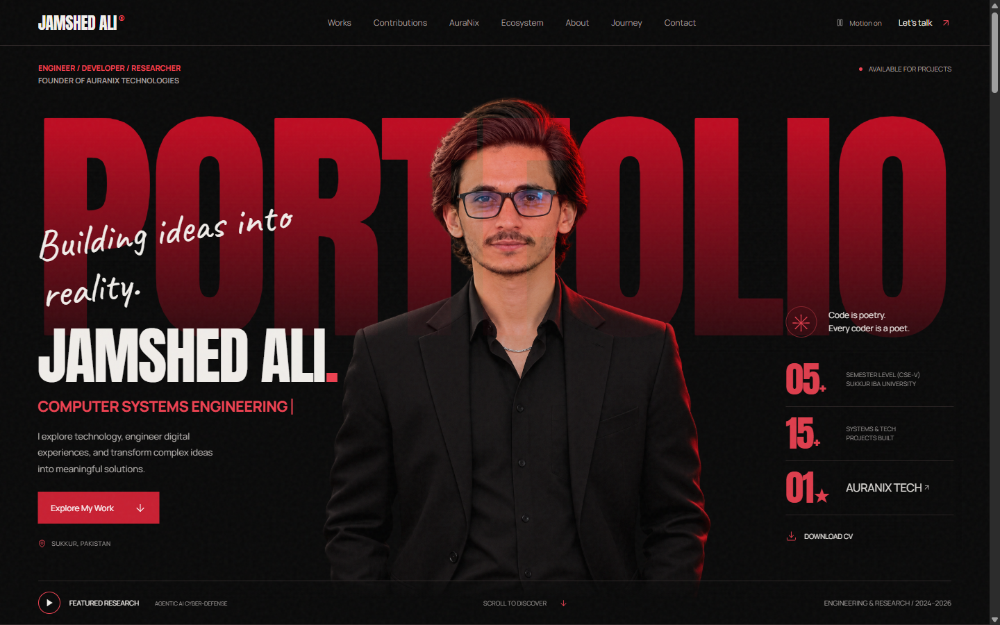
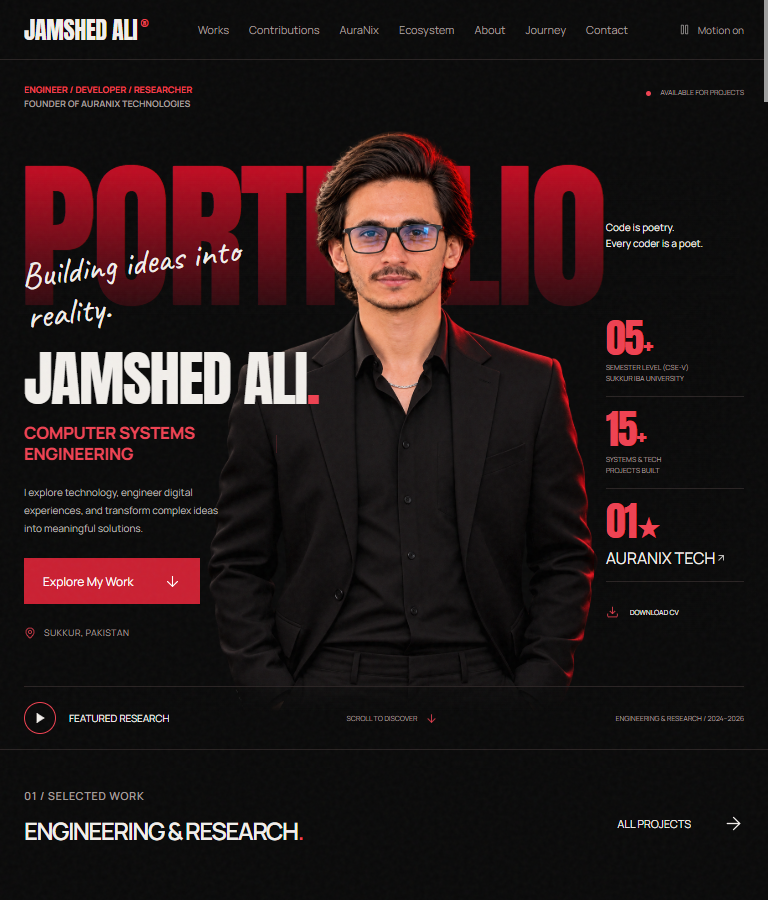
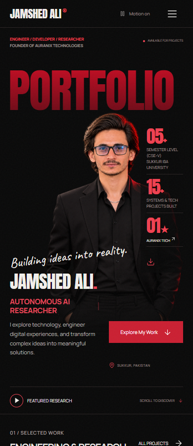

# JAMSHED ALI — Official Portfolio & Headless CMS Architecture

[](https://react.dev/)
[](https://expressjs.com/)
[](https://www.framer.com/motion/)
[](https://esbuild.github.io/)
[](https://sqlite.org/)
[](https://modelcontextprotocol.io/)

> **High-craft, dark-editorial digital portfolio, technical research archive, and headless content management system (CMS) for Jamshed Ali — Computer Systems Engineering student at Sukkur IBA University, Full-Stack Developer, AI & Cyber-Defense Researcher, and Founder/CEO of AuraNix Technologies.**

🌐 **Live URL:** [https://jamshedali.me](https://jamshedali.me) &nbsp;|&nbsp; 🏢 **Venture:** [https://auranix.tech](https://auranix.tech) &nbsp;|&nbsp; 📧 **Contact:** [engr.jamshed.ali.rind@gmail.com](mailto:engr.jamshed.ali.rind@gmail.com)

---

## 📸 Screenshots

| Desktop Viewport (1440px) | Tablet Viewport (768px) | Mobile Viewport (390px) |
| :---: | :---: | :---: |
|  |  |  |

---

## 🌟 Key Architecture & Capabilities

### 1. Cinematic Public Experience
- **Editorial Typography & Visual Hierarchy:** Oversized display typography (`Anton`, `Manrope`, `Caveat`) layered with studio cutout imagery, subtle grain textures, and fluid responsive clamps.
- **Scroll-Driven Physics:** Built on **Framer Motion 12**, featuring spring-interpolated parallax transitions, dynamic keyword transitions, interactive milestone timelines, and tilt-responsive 3D project cards.
- **Interactive Tech Ecosystem:** Interactive telemetry node inspector grouping 24+ core competencies across 4 domains (Agentic AI, Systems & Web, Cybersecurity, Hardware & Embedded Systems).
- **Responsive & Accessible:** Strict WCAG 2.1 AA compliant design with motion toggles (`localStorage` preference & `prefers-reduced-motion`), minimum 44px touch targets, and full keyboard focus trapping.

### 2. Full-Featured Headless Admin CMS
- **Secured Management Portal:** Protected `/admin` control room powered by JWT bearer authentication and bcrypt password hashing.
- **Section & Layout Customization:** Live editing of hero messaging, bio, experience timelines, project showcases, and social rails with immediate preview and draft revision rollbacks.
- **Granular Database Revisions:** SQLite-backed audit trails (`content_revisions` table) tracking all configuration updates and modifications.
- **Media Asset Pipeline:** Drag-and-drop file upload engine (`multer`) with mime validation, metadata extraction, and automatic static serving.

### 3. Agent-Readiness & Model Context Protocol (MCP)
- **Machine-Readable Endpoints:** Conforms to RFC 8288 link headers advertising machine-readable metadata on all HTTP responses.
- **Built-in MCP Server:** Implements Model Context Protocol tools (`get_bio`, `get_projects`, `submit_inquiry`) at `/api/mcp` allowing autonomous AI agents to query portfolio data and submit inquiries programmatically.
- **Structured Context Files:** Provides `/llms.txt`, `/llms-full.txt`, and `/index.md` formatted specifically for large language model indexing and agent cognition.

---

## 🛠️ Technology Stack

| Layer | Technologies |
| :--- | :--- |
| **Frontend Framework** | React 19.2.0, React DOM 19.2.0 |
| **Motion & Animation** | Framer Motion 12.23.0 |
| **Icons & Typography** | Lucide React 0.468, Anton, Manrope, Caveat (Google Fonts) |
| **Bundler & Tooling** | esbuild 0.25 (targeting ES2020 with JSX automatic runtime) |
| **Styling** | Vanilla CSS with fluid design tokens, dark editorial variables, and container queries |
| **Server & API** | Node.js (ES Modules), Express 5.3.0, CORS, Multer |
| **Database & Auth** | Node.js native `DatabaseSync` (SQLite), bcryptjs, jsonwebtoken (JWT) |
| **Machine Interfaces** | MCP (JSON-RPC 2.0), RFC 8288 Link headers, Content-Signals |
| **Deployment & Hosting** | Static distribution + Express REST API with Apache `.htaccess` rewrite rules |

---

## 📂 Repository Structure

```text
├── .htaccess                       # Apache production configuration with security headers & URL rewrites
├── .well-known/                    # Machine discovery metadata
│   └── mcp/server-card.json        # MCP SEP-1649 Server Card definition
├── 404.html                        # Branded static error page
├── about.html                      # SEO-optimized static profile page
├── admin.html                      # Admin CMS entry point
├── contact.html                    # SEO-optimized static contact page
├── context.md                      # Exhaustive technical documentation & architecture spec
├── data/                           # SQLite runtime directory (managed dynamically)
│   └── .gitkeep
├── GIT_WORKFLOW.md                 # Step-by-step Git instructions for future updates
├── index.html                      # Public application entry point
├── index.md                        # LLM-readable raw markdown archive
├── llms.txt                        # Standardized LLM overview file
├── llms-full.txt                   # Deep context archive for AI agents
├── package.json                    # Project metadata, dependencies, and execution scripts
├── privacy.html                    # Data privacy policy
├── README.md                       # Repository documentation
├── robots.txt                      # Search crawler directives
├── sitemap.xml                     # XML sitemap for search engines
├── terms.html                      # Terms of service
├── Asset/                          # Static assets and media files
│   ├── cv/                         # Downloadable PDF resume
│   ├── img/                        # Logos, portraits, favicons, project previews
│   ├── svg/                        # Software badges and ecosystem brand icons
│   └── uploads/                    # Dynamic CMS uploads directory (.gitkeep)
├── scripts/                        # Automation, build, and test tooling
│   ├── build.mjs                   # Fast esbuild compilation pipeline
│   ├── check.mjs                   # Syntax and bundle verification
│   ├── find-overflow.mjs           # Viewport regression tester
│   ├── gen-assets.mjs              # Asset generator
│   ├── test-agent-readiness.mjs    # Agentic header and MCP validator
│   ├── test-cms-workflow.mjs       # Headless CMS workflow & API test suite
│   ├── test-runner.mjs             # End-to-end Chrome CDP automated test runner
│   ├── verify-clean-portfolio.mjs  # Identity & layout verification
│   └── verify-live.mjs             # Production deployment verifier
├── server/                         # Express 5 backend & database layer
│   ├── api.mjs                     # RESTful CMS endpoints & authentication routes
│   ├── auth.mjs                    # JWT verification, password hashing & rate limiting
│   ├── db.mjs                      # SQLite database initialization & seeding
│   ├── index.mjs                   # Express server entry point & MCP handler
│   └── setup-admin.mjs             # Administrative credential provisioning script
└── src/                            # Frontend source application
    ├── app.jsx                     # Core portfolio React application
    ├── styles.css                  # Design tokens, keyframes, and layout stylesheets
    ├── admin/                      # Complete Admin Dashboard React app
    │   ├── admin.css               # Admin interface design tokens & layout
    │   └── admin.jsx               # CMS management components & state machine
    ├── components/                 # Reusable UI & animation widgets
    │   ├── AnimatedTimeline.jsx    # Scroll-linked chronological timeline
    │   ├── AuraNixCursor.jsx       # Custom magnetic cursor
    │   ├── MotionTypography.jsx    # Editorial text reveal & keyword cycler
    │   ├── ProjectCardMotion.jsx   # 3D perspective spotlight cards
    │   └── TechEcosystem.jsx       # Interactive skills cluster & node inspector
    └── data/                       # Verified content records & seed manifests
        ├── brands.json             # Brand ecosystem entities
        └── projects.json           # Engineering, research & development projects
```

---

## 🚀 Getting Started

### Prerequisites
- **Node.js**: v18.0.0 or later (v22+ recommended with native `node:sqlite`)
- **npm**: v9.0.0 or later
- **Git**

### 1. Clone the Repository
```bash
git clone https://github.com/engrjamshedali/jamshed-ali-portfolio.git
cd jamshed-ali-portfolio
```

### 2. Install Dependencies
```bash
npm install
```

### 3. Environment Configuration
Copy `.env.example` to create your local `.env`:
```bash
cp .env.example .env
```
Configure your environment parameters:
```ini
PORT=3000
NODE_ENV=development
JWT_SECRET=your-custom-secure-jwt-secret-string
```

### 4. Build Bundles
Compile the React 19 applications using esbuild:
```bash
npm run build
```
This generates `Asset/dist/app.js`, `Asset/dist/app.css`, `Asset/dist/admin.js`, and `Asset/dist/admin.css`.

### 5. Start the Server
Launch the unified Express server and REST API:
```bash
npm start
```
The application will be accessible at:
- 🌐 **Public Website:** `http://localhost:3000`
- 🔒 **Admin CMS Dashboard:** `http://localhost:3000/admin`
- 📡 **REST API Content:** `http://localhost:3000/api/content`
- 🤖 **MCP Endpoint:** `http://localhost:3000/api/mcp`

---

## 🔑 Administrative CMS Setup

To create or reset your admin credentials for the CMS dashboard:

```bash
node server/setup-admin.mjs [username] [password] [email]
```
Example:
```bash
node server/setup-admin.mjs admin SecurePassword123! engr.jamshed.ali.rind@gmail.com
```

Navigate to `http://localhost:3000/admin/login` to sign in. The system generates a JWT token stored securely in the browser session for authenticated API operations.

---

## 🧪 Verification & Automated Testing

The repository includes a suite of automated diagnostic scripts:

```bash
# Check code syntax and bundle validity
npm run check

# Verify CMS workflow, login, and CRUD endpoints
node scripts/test-cms-workflow.mjs

# Verify Agent-Readiness (RFC 8288 Link headers, MCP server-card, llms.txt)
npm run test:agent

# Run full end-to-end Chrome CDP verification
node scripts/test-runner.mjs
```

---

## 🔄 Git Workflow for Future Updates

To deploy future updates cleanly to this repository, follow the standard workflow:

```bash
# 1. Stage changes (respects .gitignore)
git add .

# 2. Commit with a meaningful message
git commit -m "feat: describe your enhancements"

# 3. Push to main branch
git push origin main
```
For detailed branching rules and verification procedures, refer to [GIT_WORKFLOW.md](./GIT_WORKFLOW.md).

---

## 🛡️ Security & Privacy Architecture

- **No Secrets in Version Control:** Environment secrets (`.env`), active SQLite databases (`portfolio.db`), and user-uploaded media are strictly excluded via `.gitignore`.
- **Hardened HTTP Headers:** Configured with `X-Content-Type-Options: nosniff`, `X-Frame-Options: SAMEORIGIN`, `X-XSS-Protection`, and restrictive `Permissions-Policy`.
- **Brute Force Protection:** Built-in IP-based rate limiting on `/api/auth/login` to prevent credential stuffing.
- **Content Security Signals:** AI-crawling policy advertised as `Content-Signal: search=yes, ai-train=no` protecting intellectual property while allowing search indexing.

---

## 📄 License & Attribution

Copyright © 2026 **Jamshed Ali**. All rights reserved.

Source code and architectural structure are published for portfolio evaluation, educational study, and technical reference. Unauthorized commercial duplication of personal identity, portraits, or brand trademarks is prohibited.

For commercial licensing or software inquiries, please reach out to **AuraNix Technologies** at [contact@auranix.tech](mailto:contact@auranix.tech) or [engr.jamshed.ali.rind@gmail.com](mailto:engr.jamshed.ali.rind@gmail.com).
